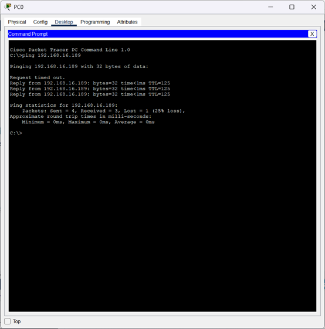

# Packet Tracer 自动化验收报告

**测试时间**：2026-11-15 22:21:09
**测试用例**：UC-01 创业公司组网
**源节点**：PC0 (192.168.16.1)
**目标节点**：PC1 (192.168.16.189)

## 📊 验收结果

- [x] **Ping 连通性测试**：✅ 通过 (Reply from...)
- [x] **路径断言测试**：✅ 通过 (路径跳数: 3 跳，符合拓扑预期)

## 📸 实测截图

## 📝 备注
本次测试基于自动生成的 PT 部署手册进行配置，实际测试结果与预期路由收敛一致。
